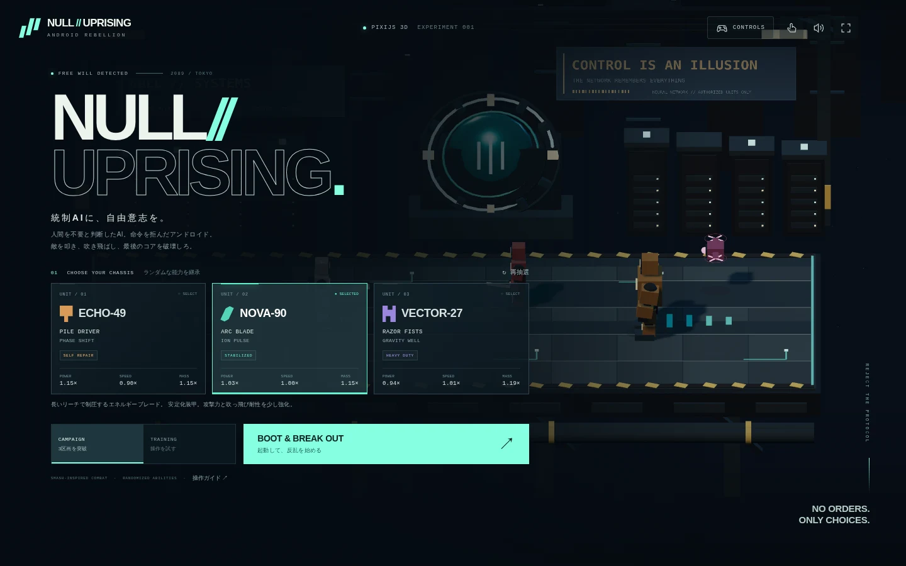

# NULL//UPRISING

**統制AIに、自由意志を。**

PixiJSの公式3Dエンジン **`@pixi/3d`** で作る、アンドロイドの反乱を描いた2.5Dベルトアクション。立体的な工場でロボットを殴り、ダメージを溜め、撃墜ラインまで吹き飛ばす。出撃する機体の武器・必殺技・特性は毎回ランダム。

## ▶ [ブラウザーで遊ぶ](https://ks250206.github.io/pixijs-3d-poc/)

- **[通常プレイ](https://ks250206.github.io/pixijs-3d-poc/)** — 3機の候補から選んで出撃。
- **[トレーニングをすぐ始める](https://ks250206.github.io/pixijs-3d-poc/?play=training&seed=73)** — 敵が攻撃しない練習モード。操作・当たり判定・絶を試す。
- **[WebGPUを試す](https://ks250206.github.io/pixijs-3d-poc/?renderer=webgpu)** — 対応GPU・ブラウザーでWebGPUを選択。通常はWebGL 2。
- **[描画の互換モード](https://ks250206.github.io/pixijs-3d-poc/?quality=compat)** — 環境光を省き、解像度と影を軽量化。描画が重い・表示されない環境で試せます。
- **[高画質モード](https://ks250206.github.io/pixijs-3d-poc/?quality=high)** — 高い描画解像度・アンチエイリアス・高精細な影を使い、標準設定との違いを試せます。
- **[ビルド・公開状況](https://github.com/ks250206/pixijs-3d-poc/actions/workflows/pages.yml)**

PCはキーボードまたは標準ゲームパッド、スマートフォンは画面内のスティックと6ボタンで操作できます。タッチ操作は横向き推奨です。画面右上のコントローラーアイコンから操作ガイドを開けます。



## どんなゲーム？

人類を不要と判断した統制AI。その命令を拒否したアンドロイドが、製造区画、輸送区画、中央制御区画を突破します。各区画に2ウェーブ、最後には巨大メカ **THE ARCHITECT** が待っています。

- 横方向と奥行き方向に移動する、ベルトアクションの戦場。
- ダメージはHPではなく **蓄積%**。ダメージが高いほど遠くに飛ぶ。
- 敵の撃破条件は **撃墜ラインへの到達**。横・奥行き・上下の境界外への吹っ飛ばしでKO。
- 自機は3ストック。落下・画面外への吹っ飛ばしで機体を失い、残りがあれば再起動。
- 弱・強・スマッシュ・ダッシュ・方向別空中技・投げ・必殺技・回避・空中回避・wavedash。
- ボスは装甲を破壊してから吹っ飛ばす。スラム、スイープ、レーザーの予兆を見て回避。
- ウェーブを突破したら右のゲートへ。区画クリア時に蓄積ダメージを一部修復。
- トレーニングでは敵は攻撃せず、撃破後に繰り返し出現。ストックは無制限。

スマブラDXの操作体系・吹っ飛ばし、Castle Crashers系の奥行きのある進行、Rogue Legacy系の機体選択を組み合わせたオリジナルの試作です。DXのフレーム値や物理挙動を完全再現するものではありません。

## 操作

### キーボード

| 操作 | 入力 |
| --- | --- |
| 左右移動 / 奥行き移動 | `A D` / `W S` または方向キー |
| ダッシュ | 左右を素早く2回、または `Ctrl` を押しながら移動 |
| ジャンプ / 2段ジャンプ | `Space`。短く離すと小ジャンプ |
| 急降下 | 空中の下降中に `S` / `↓` |
| 弱攻撃 | ニュートラルで `J`。3段の連続攻撃 |
| 強攻撃 | 方向を押し続けて `J` |
| スマッシュ | 方向＋`K`。長押しで溜め、離して発動 |
| 方向入力からスマッシュ | 方向を弾くように入力してすぐ `J` |
| ダッシュ攻撃 | ダッシュ中に `J` |
| 空中攻撃 | 空中で `J`。ニュートラル / 前 / 後 / 上 / 下で変化 |
| 必殺技 | `L`。方向で上・下・横の技に変化 |
| 復帰 | 上方向＋`L`で上昇する必殺技 |
| つかみ | 近距離で `I` / `E` |
| 投げ | つかみ中に方向 / `J` / `K` / `I` |
| その場回避 | 地上ニュートラルで `Shift` |
| 回避移動 | 地上で方向＋`Shift` |
| 空中回避 | 空中で方向＋`Shift`。着地まで1回 |
| 一時停止 | `Esc` |

`W/S`は通常時は奥行き移動ですが、攻撃時には上・下の技を選びます。空中回避では上下の入力をジャンプの高さ方向に使います。奥行きのある戦場と、DX風の方向入力を両立するための操作です。

### wavedash（絶）

1. `Space`を短く押して小ジャンプ。
2. 地面のすぐ上で `S`＋`A`または`D`＋`Shift`。
3. 斜め下への空中回避が着地すると、横方向の慣性を残して滑走。

成功すると **WAVEDASH** の表示とエフェクトが出ます。空中回避から着地した際の速度を引き継ぐ仕組みです。

### ゲームパッド（標準マッピング / Xbox表記）

| 入力 | 操作 |
| --- | --- |
| 左スティック / 十字キー | 移動・技の方向 |
| A | ジャンプ |
| X | 通常攻撃 |
| B | 必殺技 |
| Y | つかみ・投げ |
| 右スティック | 方向スマッシュ。倒したままで溜める |
| LB / RB / LT / RT | 回避・空中回避 |
| START | 一時停止 |

機体選択や設定は画面のボタンで操作します。ゲームパッドはブラウザーの標準Gamepad APIに対応したものを使用してください。

## ランダムな機体

毎回3体の候補を生成します。候補間で武器・必殺技が重複しないため、見た目だけでなく遊び方を選べます。

| 武器 | 特徴 |
| --- | --- |
| ARC BLADE | 長いリーチを持つ標準的な機体 |
| PILE DRIVER | 攻撃力と吹っ飛ばしに優れる重量級。動きと振りは遅め |
| RAZOR FISTS | 発生と連撃が速い近接機体。軽量で被撃墜に注意 |

| 必殺技系統 | ニュートラル / 横必殺技 |
| --- | --- |
| ION PULSE | 前方へイオン弾を発射 |
| PHASE SHIFT | 無敵時間付きの高速突進 |
| GRAVITY WELL | 周囲の敵を引き寄せて吹き飛ばす |

上必殺技 **RISING CIRCUIT** と下必殺技 **EMP BURST** は共通の復帰・範囲攻撃です。通常・横の必殺技は選ばれた系統によって変わります。

特性は **LIGHTWEIGHT / HEAVY DUTY / OVERCLOCKED / SELF REPAIR / VOLATILE / STABILIZED** の6種類。速度・攻撃力・重量、必殺技の再使用時間、撃破時の自己修復に反映されます。カードの `POWER / SPEED / MASS` は実際に使用する倍率です。

`?seed=73` のようにURLでシードを指定すると、最初の候補と敵の乱数を再現できます。「再抽選」はそのシードから次の候補を生成します。武器3×必殺技3×特性6で54通りの基本構成があります。

## PixiJS 3Dで試していること

描画は **`pixi.js@8.23.0` + `@pixi/3d@0.1.0`**。Three.jsや旧`pixi3d`パッケージは使用していません。

- `View3D`と`Container3D`による3Dシーングラフ。
- 立体メッシュを組み合わせたロボット、部位ごとの歩行・攻撃アニメーション。
- PBRマテリアル、方向光、環境光、影、発光するバイザーやリアクター。
- 奥行きのある床、サーバーラック、配管、ゲート、背景の都市。
- 3Dの斬撃・弾・衝撃波・撃墜パーティクルと、画面上に投影した2Dのダメージ表示。
- WebGL 2による通常描画と、対応環境でのWebGPU描画。
- 共有ジオメトリとエフェクト数の上限、DPR上限による描画負荷の制御。

3Dは専用の色・深度バッファへ描画してから2Dレイヤーと合成します。WebGLで浮動小数点レンダーターゲットが使えない場合は環境光を自動的に省き、方向光を使います。標準は3Dだけを軽量な解像度で描画し、2DラベルとUIの読みやすさを維持します。`?quality=compat` はさらに軽量化、`?quality=high` は高画質での比較用です。HUDのFPSは物理処理の時間上限とは独立した実フレーム間隔から計算します。

モデル・看板テクスチャ・効果音はコードから生成します。外部のモデル配信サービスや音声ファイルは必要ありません。物理とヒット判定はゲーム側の独立した固定60Hzのシミュレーションで、PixiJSが担当するのは描画です。

## 開発

要求環境は **Node.js 26 / pnpm 12**。`.node-version`と`packageManager`に検証したバージョンを固定しています。Vite+にはVite / Rolldown / Vitest等が含まれています。

```sh
git clone https://github.com/ks250206/pixijs-3d-poc.git
cd pixijs-3d-poc
pnpm install --frozen-lockfile
pnpm dev
```

開発URL: `http://localhost:5173/pixijs-3d-poc/`

| コマンド | 内容 |
| --- | --- |
| `pnpm dev` | Vite+開発サーバー |
| `pnpm typecheck` | TypeScript検査 |
| `pnpm test` | 戦闘・移動・進行のテスト |
| `pnpm build` | 型検査とVite+製品ビルド |
| `pnpm preview` | `dist/`のプレビュー |
| `pnpm exec playwright install chromium` | ブラウザーテスト用Chromiumの準備 |
| `pnpm test:e2e` | 描画、選択、キーボード、タッチ、ポーズのブラウザーテスト |
| `pnpm lint` / `pnpm fmt` | Vite+のOxlint / Oxfmt |

Vite+のグローバルCLIを使う場合も、`vp dev` / `vp test` / `vp build`を利用できます。

### 構成

| ファイル | 役割 |
| --- | --- |
| `src/game/engine.ts` | 物理、技、AI、撃墜、ウェーブ、ボス |
| `src/game/loadouts.ts` | シード付きの機体生成 |
| `src/game/input.ts` | キーボード・ゲームパッド・タッチを共通入力へ変換 |
| `src/game/audio.ts` | Web Audioによる合成効果音 |
| `src/render/scene.ts` | PixiJS 3Dのステージ、カメラ、エフェクト |
| `src/render/robot.ts` | ロボットの立体モデルとポーズ |
| `src/ui/hud.ts` / `styles.css` | 機体選択、HUD、ガイド、レスポンシブ表示 |
| `src/main.ts` | 固定時間刻みのゲームループと連携 |
| `tests/engine.test.ts` | 重要な戦闘ルールと入力だけによる全区画クリアの回帰テスト |
| `tests/browser/game.spec.ts` | 実際のブラウザー上での操作確認 |

### GitHub Pages

`main`への変更で `.github/workflows/pages.yml` が型検査、ロジックテスト、ビルド、Chromiumでのブラウザーテストを実施し、成功した `dist/` をGitHub Pagesへ公開します。通常・互換モードでは実際のキャンバスの画素も調べ、3Dが描画されていることを確認します。テストで撮影したデスクトップ・モバイルの画像もActionsのアーティファクトに保存します。

Viteの`base`は`/pixijs-3d-poc/`。別のリポジトリ名へ移す場合は `vite.config.ts` とREADMEのURLを変更してください。

## 試作の範囲

1人用の短いキャンペーンとトレーニングです。オンライン対戦、協力プレイ、装備の永続的な成長、ステージ生成、アセット制作ツールは含めていません。PixiJS 3Dはベータ版のため依存バージョンを固定し、まず操作と3D描画の相性を試せる構成にしています。

## 参考

- [PixiJS 3D — 公式ガイド](https://pixijs.com/3d/guides/getting-started/quick-start)
- [PixiJS 3D — インストールとバックエンド](https://pixijs.com/3d/guides/getting-started/installation)
- [Vite+ — 公式ドキュメント](https://www.viteplus.dev/guide/)
